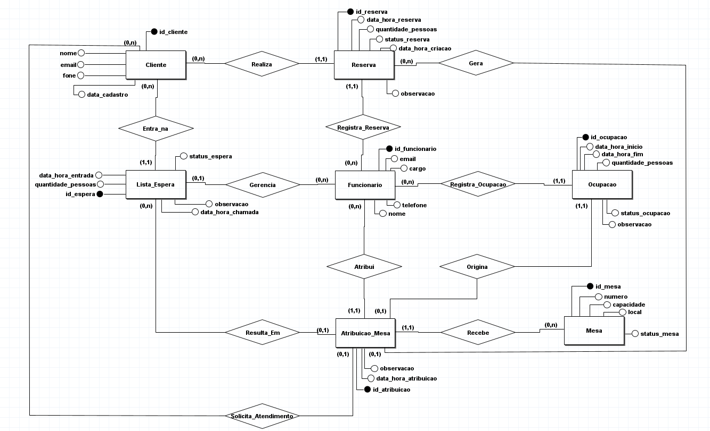
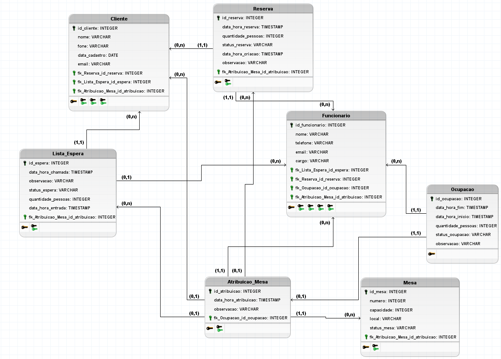
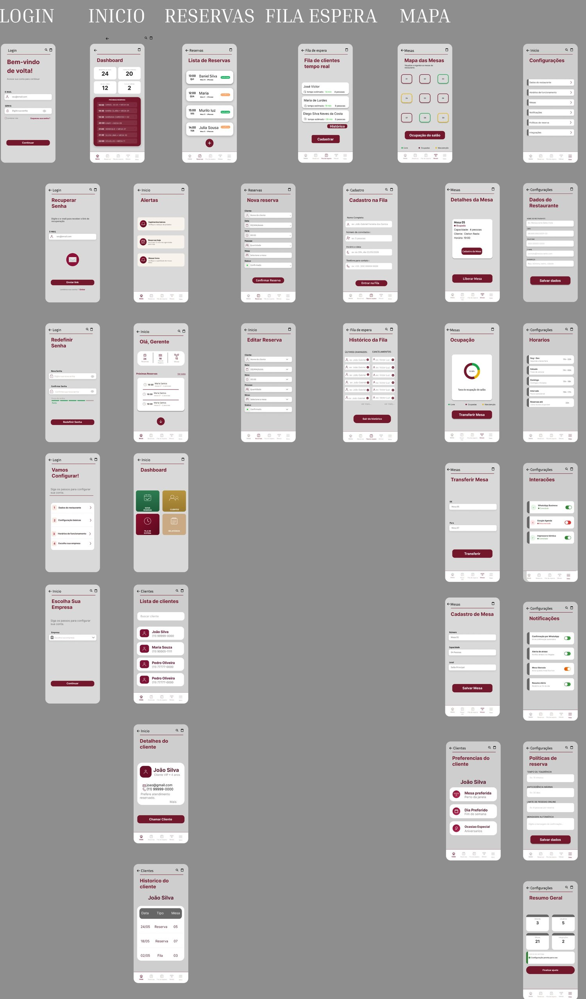
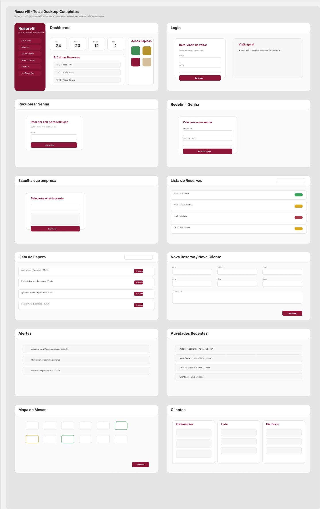
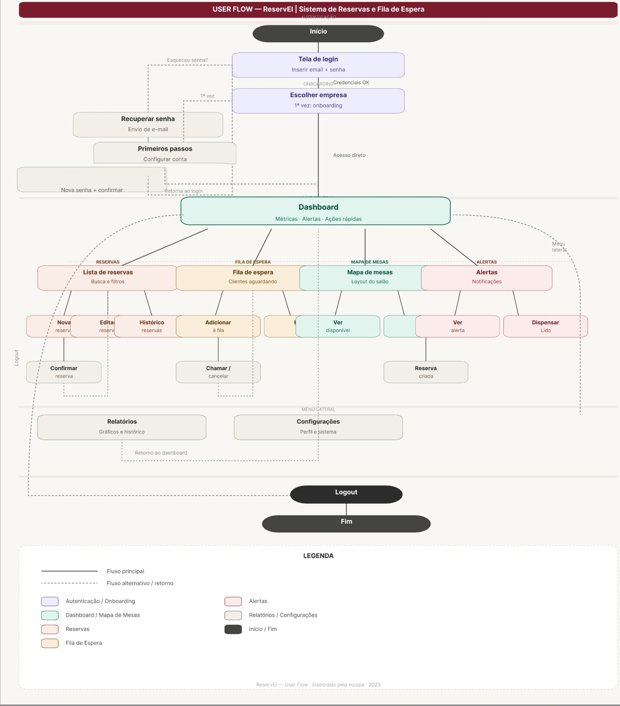

# ReservEI | Banco de dados

Banco de dados de um sistema de gerenciamento de reservas de mesas para restaurante, com cadastro de clientes e funcionários, reservas, lista de espera, atribuição de mesas e registro de ocupações.

Projeto desenvolvido em dupla na disciplina de Banco de Dados do curso de Engenharia de Software (UDF, 2026).

É a segunda etapa do **ReservEI**: no semestre anterior, nas disciplinas de Prototipagem de Sistemas Computacionais e Interface e Jornada do Usuário, o sistema foi projetado no Figma (telas mobile e desktop, fluxo do usuário e grid). Aqui, o mesmo sistema ganha a estrutura de dados que o sustentaria.

## Tecnologias

- MySQL
- MySQL Workbench
- BrModelo 3.0 (modelagem conceitual e lógica)

## Modelagem

O sistema tem 7 tabelas: `cliente`, `funcionario`, `mesa`, `reserva`, `lista_espera`, `atribuicao_mesa` e `ocupacao`.

Regras de negócio principais:

- Cada reserva pertence a um cliente e é registrada por um funcionário.
- O cliente pode entrar na lista de espera quando não há mesa disponível.
- Cada atribuição de mesa registra o funcionário, a mesa e a data, preservando o histórico de trocas.
- A ocupação registra o período real de uso da mesa.

### Modelo conceitual



### Modelo lógico



## Protótipo (etapa anterior)

As telas e o fluxo do sistema foram desenhados no Figma, em um trabalho conjunto das disciplinas de Prototipagem de Sistemas Computacionais e Interface e Jornada do Usuário.

### Telas mobile



### Telas desktop



### Fluxo do usuário



## O que tem no script

O arquivo [`ReservaMesa.sql`](ReservaMesa.sql) está organizado em partes:

1. Criação do banco e das 7 tabelas, com chaves primárias e estrangeiras.
2. Inserção de dados fictícios para teste.
3. Consultas básicas (listagens).
4. Consultas intermediárias, com `JOIN` e `GROUP BY`: reservas com o nome do cliente, atribuições com funcionário e mesa, lista de espera com cliente e quantidade de reservas por status.
5. Consultas avançadas: cliente com mais reservas e funcionário com mais atribuições.
6. Duas triggers sobre a tabela `ocupacao`:
   - `trg_ocupar_mesa`: ao registrar uma ocupação em andamento, valida a mesa e a quantidade de pessoas e marca a mesa como ocupada.
   - `trg_liberar_mesa`: quando a ocupação termina, libera a mesa automaticamente.
7. Testes das triggers: ocupar uma mesa e depois finalizar a ocupação.

## Como executar

1. Abra o MySQL Workbench e conecte ao seu servidor MySQL.
2. Abra o arquivo `ReservaMesa.sql` (File, Open SQL Script).
3. Execute o script inteiro (ícone do raio). Ele cria o banco `reservamesa`.

Ou, pelo terminal:

```bash
mysql -u root -p < ReservaMesa.sql
```

Os dados do script são fictícios.
